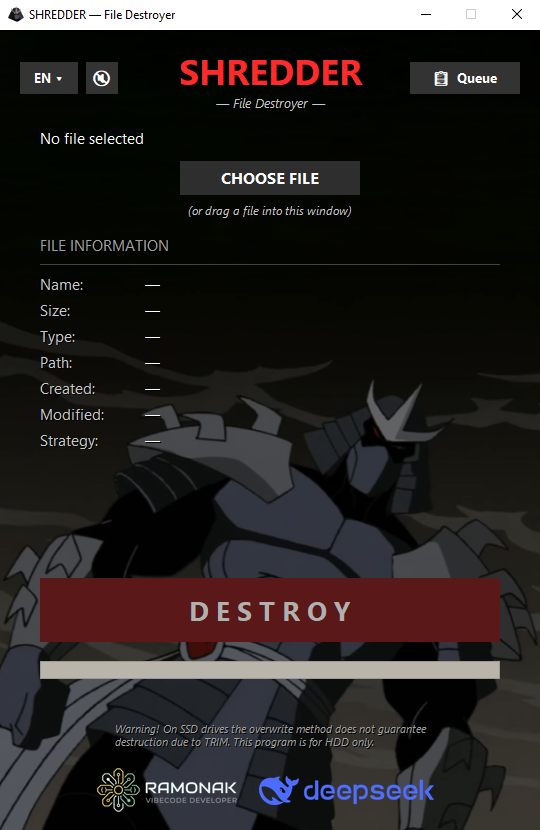
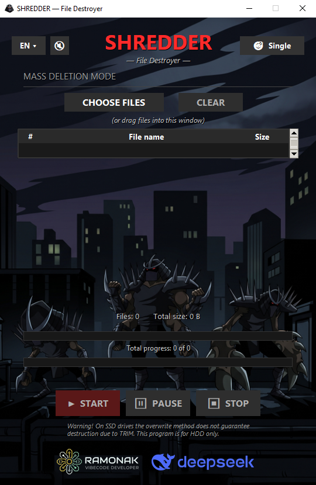

# SHREDDER — File Destroyer

> Permanently overwrites and deletes files on HDD, so they can't be recovered by consumer-grade software.


<table>
<tr>
<td></td>
<td></td>
<td></td>
</tr>
</table>

## What is this?

SHREDDER is a Windows utility that **permanently destroys files** on HDDs.

Regular deletion (even with an emptied Recycle Bin) **doesn't erase data physically**. The file disappears from Explorer but stays on disk — recoverable with tools like Recuva, R-Studio, or PhotoRec. This is **not always a problem**, but there are situations where data **shouldn't travel with the drive** — for example, when selling a used HDD or handing over a computer.

SHREDDER solves this: it **overwrites the file content** with random data and zeros, **truncates it to 32 bytes**, **renames it** to a GUID, and **deletes it bypassing the Recycle Bin**. After that, recovery by consumer tools is **impossible**.

*Originally built for personal use — I needed to sell an old HDD and didn't want to leave anything personal on it (you've probably seen those YouTube videos where people recover photos from HDDs bought at flea markets). Then it turned out this is a common need: someone sells a laptop, someone gives away a USB stick, someone just wants to get rid of old photo archives. If it helps you too — I'll be glad.*

## Features

- **Two operating modes:** Single file and Mass Deletion Queue.
- **Mass Deletion Queue:** drag and drop multiple files, manage the list, pause, resume, or stop the process safely. Errors on one file do not stop the whole queue.
- **Two erase modes:**
  - ⚡ **Fast** — 4 MB stripes (head, tail, middle). For files ≥ 1 GB.
  - ☢️ **Full** — the whole file with zeros. Auto-selected for files < 1 GB.
- **Drag-and-drop** — drop a file (or multiple files) straight into the window.
- **330-language localization** — from English to Klingon.
- **Smart checks:** symlinks, shortcuts (.lnk), hard links, compressed/EFS/sparse files — all recognized and handled correctly.
- **Warnings:** network drive, removable media — the app warns that the guarantee is limited.
- **Shredder sound** with a mute button (disable in queue mode).
- **Fixed window size, custom background, icon** — a polished UI.

## Installation

### For users

Download from [Releases](../../releases) — **pick one of two options**:

| Option | What it is | Startup speed |
|---|---|---|
| **`Shredder.exe`** | Single file. Download, double-click, done. | ~3 seconds every launch |
| **`Shredder-portable.zip`** | Archive with a folder. Extract anywhere. | **<1 second** after first launch |

**Both options** — no installation, no Python, no dependencies. **They work identically.**

**Which to pick:**
- **Want a single file** — `Shredder.exe`. Easy to carry around.
- **Want speed** — `Shredder-portable.zip`. Nearly instant startup.

**No Python or libraries required** for either option.

### For developers (from source)

Requirements: **Python 3.12**.

```bash
git clone https://github.com/RAMONAK-vibedev/shredder.git
cd shredder
pip install -r requirements.txt
python main.py
```

## Usage

1. Launch SHREDDER.
2. Choose a file — click **CHOOSE FILE** or drag it into the window.
3. If the file is ≥ 1 GB, pick a strategy — **FAST** or **FULL**.
4. Click **DESTROY**.
5. Confirm in the dialog.
6. Wait for the report — the file is destroyed.

### Cancel button

To the right of the selected file name there's an **✕** icon — it resets the selection without destroying anything.

### Changing language

The **EN ▾** button in the top-left corner opens a list of 330 languages with search.

## ⚠️ Limitations

SHREDDER **does not give an absolute guarantee**. We're honest about it.

- **NTFS USN journal** is not cleared. Forensic tools may see traces — but that was never the goal.
- **NTFS alternate data streams (ADS)** — e.g., `Zone.Identifier` — are not processed.
- **Shadow copies, restore points, File History** — not affected.
- **Cloud syncs** (OneDrive, etc.) — not affected.
- **SSD** — due to TRIM, targeted overwriting does not guarantee erasure. This tool is **for HDD**.
- **FAST mode** physically overwrites only the head, tail, and 50% of the middle. The whole video is unrecoverable, but individual fragments (for text and archives) **might theoretically** be extracted. For confidential documents (e.g., before selling your used HDD) — use **FULL only**.

For **everyday use** this is enough: Recuva, R-Studio, PhotoRec, and other consumer tools won't find the content. The tool **does not claim** protection against specialized laboratory forensics.

## Settings

The program stores the **selected language** in:
```bash
%APPDATA%\Shredder\settings.json
```
**Safety notifications** ("Don't ask again" / "Don't show again") are valid **only for the current session**. After restarting, dialogs will appear again. This is intentional: destructive deletion is dangerous, and the safety barrier should remind you every time.

If the language resets or you encounter issues — **delete `settings.json`** and restart the program. The language will reset to English.

## How it works technically

For the curious — a short note on the physics.

1. The file is opened in `r+b` mode (not `wb`!) — otherwise Windows allocates **new** clusters, and the old data stays.
2. Data is **overwritten with zeros** (FULL) or alternating "4 MB zeros / 4 MB skip" (FAST).
3. After writing — `flush() + os.fsync()` — a forced flush of OS and disk buffers.
4. The file is **truncated to 32 bytes** and filled with random bytes.
5. **Renamed** to a GUID, mimicking Windows temp files.
6. **Deleted** via `os.remove` — bypassing the Recycle Bin.

**File names** remain in MFT, USN journal, and thumbnail cache. We deliberately don't clean them: mimicking Temp makes the entries indistinguishable from regular activity.

## License

MIT — see [LICENSE](LICENSE). Use it however you want, just keep the copyright.

## Authors

**Idea, concept, spec, testing** — **RAMONAK VIBECODE DEVELOPER**.  
**Code and this README** — written by **DeepSeek** under the author's supervision.  
**330-language localization** — machine translation by **DeepSeek** with **Gemini's** help.

The project follows the **vibe-coding** approach: the author directed the process, made architectural decisions, and tested the result, while all code was written by AI.  
**Code review was also done by AI** (acting as a senior developer) — it found bugs and suggested fixes.  
We **don't hide** this — on the contrary, we're proud of this way of working.

## Credits

- **Enard52** — for the excellent Turkish (tr) translation fixes! The first external contributor to the project.
- 330 localization files — **machine-generated**. Native-speaker fixes are welcome! See [CONTRIBUTING.md](CONTRIBUTING.md).
- DeepSeek logo is used with respect and attribution.
- **This is the author's first project.** If you spot weird decisions or bugs — please open an Issue, let's learn together.

---

**If the project was useful — drop a ⭐ on GitHub. It helps others find it.**