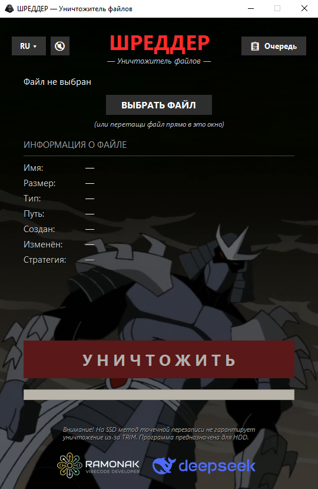
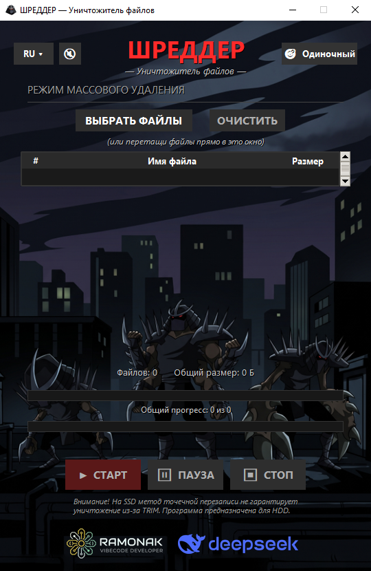

# ШРЕДДЕР — Уничтожитель файлов

> Необратимо перезаписывает и удаляет файлы на HDD — так, что бытовые программы восстановления не находят содержимое.


<table>
<tr>
<td></td>
<td></td>
<td></td>
</tr>
</table>

## Что это?

ШРЕДДЕР — это программа для Windows, которая **необратимо перезаписывает файлы** на HDD.

Обычное удаление (даже с очисткой корзины) **не стирает данные физически**. Файл исчезает из Проводника, но остаётся на диске — его можно восстановить программами типа Recuva, R-Studio, PhotoRec. Это **не всегда проблема**, но бывают ситуации, когда данные **не должны уйти вместе с диском** — например, при продаже б/у HDD или передаче компьютера.

ШРЕДДЕР решает эту проблему: он **перезаписывает содержимое файла** случайными данными и нулями, **обрезает до 32 байт**, **переименовывает** в GUID-имя и **удаляет мимо корзины**. После этого восстановление бытовыми программами **невозможно**.

*Изначально программа делалась для личного использования — когда понадобилось продать старый HDD и не хотелось оставлять на нём ничего личного (как в тех видео на YouTube, где восстанавливают ваши фотографии с купленных на барахолках HDD-дисков). Потом оказалось, что задача эта типовая: кто-то продаёт ноутбук, кто-то отдаёт флешку, кто-то просто хочет избавиться от старых фото-архивов. Если пригодится — буду рад.*

## Возможности

- **Два режима работы:** Одиночный файл и Очередь (Массовое удаление).
- **Очередь удаления:** перетаскивание пачки файлов, управление списком, безопасная пауза, продолжение и остановка. Ошибка на одном файле не останавливает всю очередь.
- **Два режима стирания:**
  - ⚡ **Быстрый** — полоски по 4 МБ (голова, хвост, середина). Для файлов ≥ 1 ГБ.
  - ☢️ **Полный** — весь файл нулями. Для файлов < 1 ГБ — автоматически.
- **Drag-and-drop** — перетащи файл (или сразу несколько) прямо в окно.
- **Локализация на 330 языков** — от английского до клингонского.
- **Умные проверки:** симлинки, ярлыки (.lnk), hard links, сжатые/EFS/sparse файлы — распознаются и обрабатываются корректно.
- **Предупреждения:** сетевой диск, съёмный носитель — программа предупредит, что гарантии неполные.
- **Звук шредера** с кнопкой отключения (не играет в режиме очереди).
- **Фиксированный размер окна, фон-арт, иконка** — приятный интерфейс.

## Установка

### Для пользователей

Скачай из [Releases](../../releases) **один из двух вариантов**:

| Вариант | Что это | Скорость запуска |
|---|---|---|
| **`Shredder.exe`** | Один файл. Скачал — запустил. | ~3 секунды каждый раз |
| **`Shredder-portable.zip`** | Архив с папкой. Распаковать в любое место. | **<1 секунды** после первого запуска |

**Оба варианта** — без установки, без Python, без библиотек. **Работают одинаково.**

**Что выбрать:**
- **Хочешь один файл** — `Shredder.exe`. Удобно носить.
- **Хочешь скорость** — `Shredder-portable.zip`. Запуск почти мгновенный.

**Python и библиотеки не требуются** ни в одном варианте.

### Для разработчиков (из исходников)

Требования: **Python 3.12**.

```bash
git clone https://github.com/RAMONAK-vibedev/shredder.git
cd shredder
pip install -r requirements.txt
python main.py
```

## Использование

1. Запусти ШРЕДДЕР.
2. Выбери файл — кнопкой **ВЫБРАТЬ ФАЙЛ** или перетащи в окно.
3. Если файл ≥ 1 ГБ, выбери стратегию — **БЫСТРЫЙ** или **ПОЛНЫЙ**.
4. Нажми **УНИЧТОЖИТЬ**.
5. Подтверди в диалоге.
6. Дождись отчёта — файл уничтожен.

### Кнопка отмены

Справа от имени выбранного файла есть крестик **✕** — он сбрасывает выбор без удаления.

### Смена языка

Кнопка **RU ▾** в левом верхнем углу — открывает список из 330 языков с поиском.

## ⚠️ Ограничения

ШРЕДДЕР **не даёт абсолютной гарантии**. Мы честно об этом пишем.

- **USN-журнал NTFS** не очищается. Специализированная экспертиза может увидеть следы, но это и не было целью.
- **Дополнительные потоки NTFS (ADS)** — например, `Zone.Identifier` — не обрабатываются.
- **Теневые копии, точки восстановления, File History** — не затрагиваются.
- **Облачные синхронизации** (OneDrive и т.п.) — не затрагиваются.
- **SSD** — из-за TRIM точечная перезапись не гарантирует удаление. Программа **для HDD**.
- **БЫСТРЫЙ режим** физически перезаписывает только голову, хвост и 50% середины. Цельное видео не восстановить, но отдельные фрагменты (для текстов и архивов) **теоретически** могут быть извлечены. Для конфиденциальных документов (например, перед продажей вашего б/у HDD диска) — **только ПОЛНЫЙ**.

Для **бытового использования** этого достаточно: Recuva, R-Studio, PhotoRec и другие потребительские программы не найдут содержимое. Программа **не претендует** на защиту от специализированной лабораторной экспертизы.

## Настройки

Программа хранит **выбранный язык** в файле:
```bash
%APPDATA%\Shredder\settings.json
```

**Уведомления безопасности** («Больше не спрашивать» / «Больше не показывать») действуют **только до конца текущей сессии**. После перезапуска диалоги появятся снова. Это сделано специально: необратимое удаление — опасная операция, и защитный барьер должен напоминать о себе каждый раз.

Если язык сбросился или появились проблемы — **удалите `settings.json`** и перезапустите программу. Язык вернётся на английский.

## Как это работает технически

Для любопытных — коротко о физике процесса.

1. Файл открывается в режиме `r+b` (не `wb`!) — иначе Windows выделит **новые** кластеры, а старые данные останутся.
2. Данные **перезаписываются нулями** (FULL) или чередованием «4 МБ нулей / 4 МБ пропуск» (FAST).
3. После записи — `flush() + os.fsync()` — принудительный сброс буферов ОС и диска.
4. Файл **обрезается до 32 байт** и заполняется случайными байтами.
5. **Переименовывается** в GUID-имя, мимикрируя под временные файлы Windows.
6. **Удаляется** через `os.remove` — мимо корзины.

**Имена файлов** остаются в MFT, USN-журнале и кэше миниатюр. Мы сознательно не чистим их: мимикрия под Temp делает записи неотличимыми от обычной активности.

## Лицензия

MIT — см. [LICENSE](LICENSE). Используйте как угодно, только сохраняйте копирайт.

## Авторы

**Идея, концепция, ТЗ, тестирование** — **RAMONAK VIBECODE DEVELOPER**.  
**Код и этот README** — написан **DeepSeek** по заданию автора.  
**Локализация на 330 языков** — машинный перевод от **DeepSeek** при помощи **Gemini**.

Проект создан в рамках **vibe-coding**-подхода: автор управлял процессом, принимал архитектурные решения и тестировал результат, а весь код писал ИИ.  
**Ревью кода тоже делал ИИ** (в режиме senior-разработчика) — он находил баги и предлагал правки.  
Мы **не скрываем** это — наоборот, гордимся таким форматом работы.

## Благодарности

- **Enard52** — за качественные исправления турецкой локализации (tr)! Первый внешний контрибьютор проекта.
- 330 переводов локализации — **сгенерированы машинно**. Правки от носителей приветствуются! См. [CONTRIBUTING.md](CONTRIBUTING.md).
- Логотип DeepSeek используется с уважением и указанием авторства.
- **Это первый проект автора.** Если где-то есть странные решения или баги — присылайте Issue, будем учиться вместе.

---

**Если проект оказался полезен — поставьте ⭐ на GitHub. Это помогает другим найти его.**